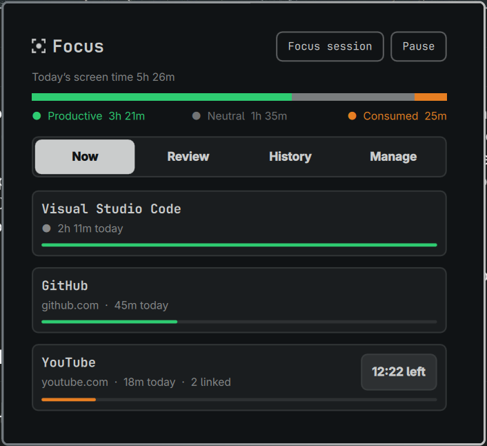
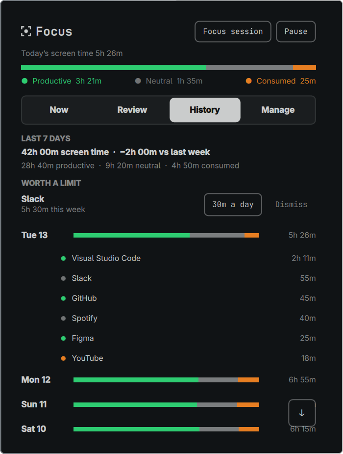
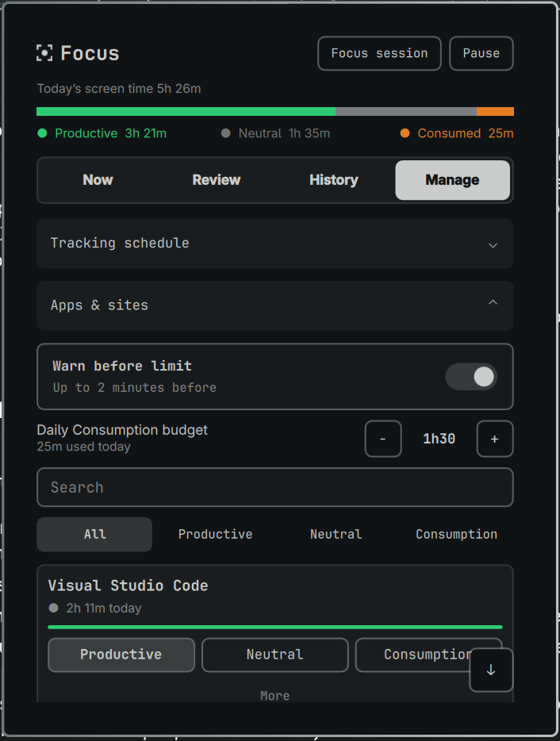
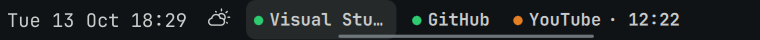

<p align="center"></p>

# Focus

Stay focused. Understand your screen time and keep distractions in check.

Focus tracks the apps and websites you actually look at, separates productive work
from consumption, and enforces the limits you choose. Built for Omarchy Linux.
Everything stays on your computer.

<p align="center">
  
  
  
</p>

<p align="center"></p>

- **Screen time without double counting**, by app and by website, during your schedule.
- **Limits per hour or per day**, a daily Consumption budget, and a choice of
  closing, notifying or keeping open when a limit is reached.
- **Focus sessions** of 25, 50 or 90 minutes that block all Consumption.
- **5 more minutes**, once per limit period, from the notification or the panel.
- **History** with daily details, a weekly summary and suggested limits.
- **Smart grouping** of an app with its website and of a site's subdomains.

## Install

Requires Omarchy Linux, Python 3, libpsl, python-gobject and a systemd user session. The helper is required;
installing the widget alone does not start tracking.

Install an exact commit, never the moving `main` branch: the helper runs as a user service.
On the [Omarchy marketplace page](https://plugins.omarchy.org/plugin.html?id=io.github.noflairos.focus-ratio),
open the *Verified snapshot* link and copy its full 40-character commit (or take the commit
of a [release](https://github.com/NoFlairos/focus/releases)), then:

```sh
commit=FULL_40_CHARACTER_COMMIT
git clone https://github.com/NoFlairos/focus.git
cd focus
git checkout --detach "$commit"
./scripts/install-local.sh

plugin_dir="${XDG_CONFIG_HOME:-$HOME/.config}/omarchy/plugins/io.github.noflairos.focus-ratio"
mkdir -p "$plugin_dir"
install -m 0644 manifest.json BarWidget.qml Panel.qml FocusMark.qml "$plugin_dir/"
omarchy plugin enable io.github.noflairos.focus-ratio
omarchy restart shell
```

For websites, install the [Focus extension from the Chrome Web Store](https://chromewebstore.google.com/detail/dmeieacelhalokmjoijllpieglfjojjo)
in Chromium or Google Chrome. The helper installer registers it automatically.

For websites during development, load `~/.local/share/focus-ratio/browser` in `chrome://extensions`
with Developer mode enabled. Copy its ID, then run:

```sh
./scripts/install-browser-host.sh EXTENSION_ID
```

Restart Chromium or Google Chrome. The extension popup should show **Connected**.
Without the extension, the browser is tracked as one desktop app.
Paths follow your XDG settings when configured.

## Use

| Page | What it does |
| --- | --- |
| **Now** | Apps and sites on screen, time left, and *Limit reached* with 5 more minutes. |
| **Review** | Classify or exclude entries used 10+ minutes over the last 7 days. |
| **History** | Last 7 days; click a day for its top entries. *Worth a limit* suggestions. |
| **Manage** | Schedule (saved automatically), apps & sites, connection and data export. |

The header starts a **Focus session** or **pauses** tracking. Clicking an entry's name
in Now opens it in Manage. Each entry's **More** holds its limit period and action,
subdomain mode, linked members, Merge into and Exclude.

Defaults: weekdays 08:00–17:00, a 10-minute hourly limit for Consumption that closes
the window or active tab, and days starting at 04:00 so late nights count toward the
evening before. The limit notification stays on screen until you choose.

Screen time counts simultaneous activity once. Per-app totals can therefore
exceed screen time. Tracking stops while paused, idle, locked or outside the schedule.
Mapped windows can count even when covered; background tabs do not count, and
ambiguous browser titles are skipped.

Linked entries share settings and one counter. Merging adds existing history,
which cannot be split afterward; Detach starts an independent counter with the
same settings. Subdomains have three modes:

- **Smart** (default): subdomains of a site join it unless they declare their own
  web-app manifest or application name, or you gave them another category.
  Sibling projects on hosting domains (`*.pages.dev`) join only with a shared identity.
- **Group:** join every site in the domain family, hosting projects included.
- **Separate:** keep new sites independent; existing links remain.

Domain boundaries come from the system libpsl data. Detached, excluded and dismissed
entries stay independent. Same-name entries across domains appear as suggestions.

Classified entries can be excluded without losing their settings or history.
Excluding an unclassified entry deletes its pending history. Track again restores
the entry immediately. Excluded entries stay in a collapsed list.

## Data and removal

Data stays on this computer. [Privacy and deletion](PRIVACY.md) ·
[Public privacy policy](https://noflairos.github.io/focus/privacy.html)

```sh
omarchy plugin disable io.github.noflairos.focus-ratio
./scripts/uninstall-local.sh
```

Remove the widget directory created above if no longer needed. Settings and
history are retained. Data export provides CSV history and JSON settings backups;
clearing history also resets current limits but keeps settings and exported files.
To restore settings, stop `focus-ratio.service`, replace
`~/.config/focus-ratio/config.json` with the backup, then restart the service.

## Development

```sh
./scripts/check.sh                   # Python, Node.js, QtTest and Omarchy
./scripts/check-isolated.sh          # also requires bubblewrap and Chromium
python3 scripts/build-release.py     # local archives in dist/
```

[Validation](release/VALIDATION.md) · [Publication files](release/README.md) ·
[Support](https://github.com/NoFlairos/focus/issues)

Public name: Focus. Technical IDs and data paths retain `focus-ratio` for compatibility.
